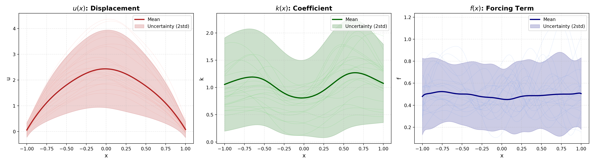

# PI-VAE reproduction

本项目基于 Weiheng Zhong 与 Hadi Meidani 的论文 **PI-VAE: Physics-Informed Variational Auto-Encoder for stochastic differential equations** 及其实现进行复现、检查和可视化整理。PI-VAE 方法归原论文作者所有，本仓库不主张该方法为仓库维护者的原创成果。

- 论文：https://arxiv.org/abs/2203.11363
- 发表版本：Computer Methods in Applied Mechanics and Engineering, 403 (2023), 115664。
- DOI：https://doi.org/10.1016/j.cma.2022.115664
- 原代码版权声明：Copyright (c) 2022 WeihengZ；完整保留原始 [MIT LICENSE](LICENSE)。

## 内容与当前状态

| 路径 | 用途 |
| --- | --- |
| `lib/training_data.py` | 采样随机系数和源项，用有限差分生成解场 |
| `lib/models.py` | PI-VAE 网络、MMD 损失、自动微分物理算子 |
| `lib/data_loader.py` | 从传感器观测构造训练批次 |
| `examples/SDE.py` | 训练入口及训练期间的统计误差计算逻辑 |
| `examples/test_plot.py` | 加载本地模型，生成并绘制 u、k、f；不是自动化测试 |
| `lib/visualization.py` | 可视化代码及保留的历史实现 |
| `examples/results/SDE/` | 已有的小型结果图 |
| `requirements.txt` | 原项目固定版本的依赖清单 |

保留源代码、依赖清单、许可证及已有结果图。模拟数据、模型权重、缓存、训练日志和本地环境由 `.gitignore` 排除，克隆后需要自行准备；Git 忽略规则不会删除本地文件。

现有图展示模型采样的均值、均值 ± 2 倍逐点标准差及部分样本路径。脚本从四维标准正态潜变量生成 100 个样本，在 400 个空间点计算 u、k，再由物理算子计算 f；它不读取参考数据，也不绘制参考解误差。图片不是完整论文复现或独立测试精度的证明。仓库没有随附可追溯的训练日志、训练轮数记录或独立测试报告。



## 物理问题

代码实现一维随机系数边值问题：

$$
-0.1\frac{d}{dx}\left(k(x,\omega)\frac{du(x,\omega)}{dx}\right)=f(x,\omega),\quad x\in(-1,1),
$$

$$
u(-1,\omega)=u(1,\omega)=0.
$$

数据生成器先采样 k 和 f，再求解 u。`ODE` 分支使用
`k(x) = exp(0.2 * sin(1.5 * pi * (x + 1)) + khat(x))`；khat 为零均值高斯过程，f 为均值 0.5 的高斯过程，相关长度分别为 1.0 和 0.2。`mesh_size=400` 在数据生成器中表示 400 个区间、401 个节点。

`u_sensor=2, k_sensor=17, f_sensor=21` 是仅给定 u 的两端边界值以及 k、f 传感器观测的随机正问题配置。网络学习连续 u、k 场，f 由 `-0.1 * (k_x * u_x + k * u_xx)` 得到；不能仅因同时输出三个场就将其称为反问题。训练损失使用观测联合分布的 MMD 和潜变量分布的 MMD。

## 环境配置

原始依赖固定了 PyTorch 1.7.1、torchvision 0.8.2、NumPy 1.19.2 等旧版本。可用 Python 3.8 创建隔离环境作为安装起点；这不是已重新验证通过的安装组合，不应假定旧版依赖支持现代 Python。

下列命令从仓库根目录开始，除非显式切换目录：

```bash
python3.8 -m venv .venv
source .venv/bin/activate
python -m pip install -r requirements.txt
```

本地检查曾在 Python 3.12 / PyTorch 2.5.1 下成功加载现有模型并做 CPU 推理，但未在此环境重新训练或验证整个依赖清单，因此不代表端到端兼容。代码使用相对路径，请遵循下述工作目录。

## 运行方法与已知限制

### 1. 生成模拟数据

建立被 Git 忽略的输出目录，再运行生成器：

```bash
mkdir -p database/SDE examples/trained_model/SDE examples/results/SDE
cd lib
python training_data.py --case=ODE --kl=1.0 --fl=0.2 --mesh_size=400 --data_size=2000
```

输出为 `database/SDE/{u,k,f}_ODE.npy`，每个数组对应 2000 条样本、401 个节点。`ODE` 分支的相关长度在代码中固定为 1.0 和 0.2。生成命令会写入同名本地数据文件。

原项目还提供以下生成配置（从 `lib/` 运行），本仓库未声明已验证这些实验结果：

```bash
python training_data.py --case=ODE_khigh --kl=0.02 --fl=1.0 --mesh_size=400 --data_size=5000
python training_data.py --case=ODE_fhigh --kl=1.0 --fl=0.02 --mesh_size=400 --data_size=5000
```

### 2. 训练入口：当前存在阻塞，不能保证直接运行成功

`examples/SDE.py` 调用 `std_cal`，但 `lib/visualization.py` 中的定义已被注释。当前源码执行到该调用时会缺少函数定义，需先修复和验证后再训练。本次仓库整理没有修改算法代码或重新训练。

被注释的旧 `std_cal` 返回全空间汇总的一个标量，不是逐点标准差曲线；不宜直接恢复它并将结果解释为逐点标准差误差。原训练脚本没有将 loss、误差或耗时历史保存到文件，参考统计来自训练所用数据而非独立测试集。

修复上述问题并准备数据后，原项目的训练调用方式如下（从仓库根目录进入 `examples/`）：

```bash
cd examples
python SDE.py --case=ODE --u_sensor=2 --k_sensor=17 --f_sensor=21 --mesh_size=400 --data_size=2000 --latent_dim=4 --epoch=2000
```

循环结束后保存完整模型对象到 `examples/trained_model/SDE/`。2000 是请求训练的轮数，不代表已有模型实际完成的轮数；保存操作可能覆盖同配置的已有文件。

原 README 的其他调用配置保留如下，亦需先修复上述问题：

```bash
python SDE.py --case=ODE --u_sensor=6 --k_sensor=6 --f_sensor=21 --mesh_size=400 --epoch=2000
python SDE.py --case=ODE --u_sensor=11 --k_sensor=1 --f_sensor=21 --mesh_size=400 --epoch=2000
python SDE.py --case=ODE_khigh --u_sensor=2 --k_sensor=51 --f_sensor=21 --mesh_size=400 --epoch=2000 --data_size=5000
python SDE.py --case=ODE_fhigh --u_sensor=2 --k_sensor=17 --f_sensor=51 --mesh_size=400 --epoch=2000 --data_size=5000
```

### 3. 使用已有本地模型绘图

将可信的完整 `PIVAE_SDE` 模型 `.pkl` 放入 `examples/trained_model/SDE/`，再从仓库根目录运行：

```bash
python examples/test_plot.py
```

脚本选择修改时间最新的模型，硬编码潜变量维度为 4，使用 CPU 推理，并保存 `examples/results/SDE/PHYSICS_RECONSTRUCTION_<timestamp>.png`。仓库不分发权重，全新克隆后不能直接重现图片。完整对象加载依赖对应 Python 类和兼容的 PyTorch 加载行为，勿加载来源不明的 pickle 文件。

生成器未硬编码零边界或 k 的正值约束；本地检查发现生成 u 的边界存在偏差。f 通过 u、k 的导数定义，算子自洽不等于已独立验证解的准确性。独立测试、边界误差、逐点统计、空间相关性及其他传感器配置仍需系统验证。

## 引用与许可证

使用原论文方法时，请引用原作者论文：

```bibtex
@article{ZHONG2023115664,
title = {PI-VAE: Physics-Informed Variational Auto-Encoder for stochastic differential equations},
journal = {Computer Methods in Applied Mechanics and Engineering},
volume = {403},
pages = {115664},
year = {2023},
issn = {0045-7825},
doi = {https://doi.org/10.1016/j.cma.2022.115664},
url = {https://www.sciencedirect.com/science/article/pii/S0045782522006193},
author = {Weiheng Zhong and Hadi Meidani},
}
```

原始 MIT 许可证及 WeihengZ 的版权声明完整保留在 [LICENSE](LICENSE) 中。
